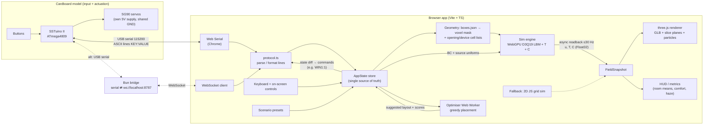

# 01 · Architecture

## MVP amendment · implemented architecture

**This section supersedes the original 3D/WebGPU architecture below.** The main apartment uses the documented 2D fallback. Cooling Lab is an independent two-layer/surface model and does not replace that field with a 3D solver. See [simulation details](02-simulation.md), [run commands](../README.md) and [verification status](../CHECKLIST.md).

The visible workspaces are **My flat**, **Window fan test** (Cooling Lab), and **Compare floor plans** (Contractor Study). All simulation runtime work stays in the browser. `src/domain.ts` imports the canonical `assets/hdb-3d/hdb_4room_boxes.json`; the original Flat renderer/solver, Cooling Lab and physical pack use that geometry. The separately authorized Contractor Study accepts a validated plan under the contract in [the study guide](contractor-study.md); it must keep its geometry and state separate. There is no backend, account system, deployment dependency or sensor feed. Simulation weather is manually entered; an optional external Windy reference display does not feed data to the model. The app works with no board attached.

| Implemented module | Responsibility |
|---|---|
| `src/app.ts`, `src/homeowner-advice.ts` | Homeowner controls, explicit suggestion differences/Apply/Undo, current `Conditions`, scenarios, keyboard access, simulation clock, readings, exports and optimiser UI. |
| `src/domain.ts` | Shared geometry, `Conditions`, room readings and `PlanField` contract. |
| `src/plan-simulation.ts` | 64 × 48 floor-plan mask, CPU steady pressure/face-flow solution, scalar preparation/CPU transport and room summaries. |
| `src/plan-gpu.ts` | Optional WGSL heat/PM2.5 transport using the same CPU face flow; async readback and failure cleanup. |
| `src/thermal-types.ts`, `src/thermal-model.ts` | Canonical HDB instance plus isolated imported-plan instances of the two-layer/surface model. |
| `src/contractor-plan.ts`, `src/contractor-study.ts` | Validated rectangular-plan input, three-plan UI, shared manual brief and geometry preview. |
| `src/contractor-comparison.ts`, `src/contractor-worker.ts`, `src/contractor-export.ts` | Three plan-specific worker runs, metric-specific shortlist, HTML/JSON handoff. |
| `src/thermal-comparison.ts`, `src/thermal-worker.ts` | Quick fan-off/on or captured baseline/candidate experiments from one shared initial thermal state. |
| `src/air-quality.ts` | Manual scenario PM2.5 / US EPA 24-hour-scale index-equivalent conversion; no data feed. |
| `src/cooling-lab.ts`, `src/thermal-export.ts`, `src/fan-thermodynamics.ts` | Lab UI, reproducible CSV and separate educational ideal-expansion calculation. |
| `src/scene.ts`, `src/scene-field.ts` | three.js WebGL scene built from JSON, opening/device animations, masked field texture and display tracers. |
| `src/simulation.ts` | Six scenario records and presets; also contains a tested emergency well-mixed room model that the main app does not select. |
| `src/config/slots.ts`, `src/config/mapping.ts` | Shared portable-device locations and exact hardware-to-opening names. |
| `src/io/protocol.ts`, `src/hardware.ts`, `src/main.ts` | Pure protocol parser, optional Web Serial lifecycle and idempotent app/board state synchronization. |
| `src/optimiser.ts`, `src/optimiser.worker.ts` | Same 2D engine in a dedicated worker; compares fresh scenarios and returns layouts for explicit Apply. |
| `scripts/build-pack.py` | A4 templates, exact cut schedules, clearance checks and shareable ZIP. |

The frame loop advances the CPU planar solver, or submits its prepared heat/haze step to WebGPU when available, and paints the HUD/scene data about four times per second. Rendering has its own animation loop. If WebGL scene creation fails, the app uses a labelled JSON-derived 2D plan with room values and actual planar-solver arrows; this is separate from GPU-compute fallback. Playback offers target speeds of 1×, 30× and 60×; elapsed simulation time and energy use the amount actually advanced. Busy devices may run slower than the target. Hidden tabs and the flat while Cooling Lab is selected do not advance. Frame delta is capped at 0.25 real seconds. The CPU advances at most one simulated second per animation frame; GPU pending time is capped at 15 simulated seconds. This bounds catch-up work without promising a frame rate.

The solver retains cached flow/source data while controls are unchanged. The CPU path uses typed arrays. The optional GPU scalar path performs nonblocking staging-buffer readback with at most one request in flight; CPU flow remains authoritative. Epoch checks reject stale results after controls/reset/workspace changes, and GPU loss or error resumes CPU processing from the last completed state. Nonfinite field values are bounded/recovered; unexpected simulation errors pause the loop with a notice. Optimiser work is isolated in a cancellable worker and a failed comparison does not replace the current layout.

### Contractor Study geometry isolation

The separate workspace accepts `ContractorPlan` v1 through `src/contractor-plan.ts`, which validates metre-based rectangular rooms, explicit connections and safe unique IDs. `createThermalModel(plan)` creates a plan-specific model context; its state is bound to that normalized plan, while canonical exports retain the original HDB instance. The displayed **Plan input fingerprint** includes normalized metadata, default states and devices as well as geometry. It is a content identifier, not a geometry-equivalence test, security hash or surveyed-geometry certificate.

The study compares three independently sized plans with shared weather, initial concentrations/temperatures, total occupancy and duration. It does not clone one HDB state into different room counts. Plan inputs, initial settings and results remain reviewable in the handoff; imported geometry does not alter hardware mapping, the main planar field or the cardboard generator. See [the JSON and workflow contract](contractor-study.md).

### Cooling Lab separation

Cooling Lab uses its own `ThermalConfig`, `ThermalState` and `ThermalSnapshot` contract in `src/thermal-types.ts`. Its two air layers, interior surface state and massless exterior-face balance per room derive dimensions from the same canonical JSON. These are separate from the planar `PlanField`; no laboratory temperature or fan result silently overwrites the main scene.

The paired comparison runs in a dedicated worker from clones of one initial thermal state. Quick mode changes only `vent.on`. Configuration mode restores captured baseline interventions (openings, devices, fan and envelope) while using the current candidate scenario/weather, wind direction, optional main-door corridor boundary and duration for both arms. The corridor is a prescribed fixed reservoir only at the exterior `main_door`, not resolved shared-corridor geometry or the internal corridor rooms. Cancelling terminates the worker; a partial or stale run must not be presented as a completed pair. This is a controlled comparison, not the existing layout optimiser.

The educational ideal-expansion calculation is independent of both solvers. It uses explicitly entered absolute pressure/pressure drop; the main scene's dimensionless pressure index is not a pressure input.

USB is optional. The default `SINGLE_PURIFIER_SWITCH = 1` sketch now uses **D4 press-to-toggle** for both Bedroom 3 windows (`WIN1` north, `WIN4` east) and **D5 hold-to-enable** for the Bedroom 3 corner purifier (`PUR`). Both inputs debounce for 30 ms; D4 holds/releases do not repeat the toggle. Startup and `GET:ALL` report only these owned states, preserving the fan, weather and unrelated openings. Window commands from the app can still change either window independently; the next D4 press closes both if both are open, otherwise opens both. `WIN2`/`WIN3` retain the living-room mapping. Servo outputs remain disabled; flag `0` retains the alternative WIN1/D5 and DOOR1/D6 mode. The supplied board's upload and physical USB round trip remain unverified; see [hardware guide](hardware.md), including the board-specific D4 note. There is no WebSocket bridge or automatic 3D backend selection in this MVP.

Written by gpt-6-astra in Codex on behalf of Edmund

<details>
<summary>Original roadmap / reference specification — not a statement of shipped functionality</summary>

## Runtime picture
Everything runs on **one M4 Pro MacBook in Chrome** from `http://localhost` (a Vite dev server or `vite preview`). Web Serial and WebGPU both need a secure context, and `localhost` counts as one [U: confirm on the day by opening the page and checking `window.isSecureContext`]. There is no backend. The optional Bun bridge is a local helper process.



## Modules (contracts)
| Module | Input | Output | Notes |
|---|---|---|---|
| `geometry/` | `assets/hdb-3d/hdb_4room_boxes.json`, grid params | `VoxelGrid { nx,ny,nz,dx,origin, cellType:Uint8Array, openings: Map<name,Uint32Array cellIdx>, devices: Map<name,...>, roomOf: Uint8Array }` | Pure TS, unit-tested. **Only the JSON drives physics.** The GLB is visual only. |
| `sim/` | `VoxelGrid`, `SimParams`, `BoundaryState` | `FieldSnapshot { ux,uy,uz,T,C: Float32Array, step, simTime }` | WebGPU compute (WGSL). A CPU TS reference implementation of the same maths is used in tests and the optimiser. |
| `sim/fallback2d/` | 2D floor-plan raster | same `FieldSnapshot` shape with `ny=1` | Used if WebGPU fails (see doc 07). |
| `render/` | GLB, `FieldSnapshot`, `AppState` | canvas | three.js `WebGLRenderer` (see doc 03 for why not `WebGPURenderer`). |
| `io/` | serial/WS bytes, keyboard | `InputEvent`s → store, store diffs → command lines | Same parser for Web Serial and WS. |
| `optimiser/` | `AppState` snapshot (scenario, open/closed openings, current devices) | top-3 layouts with scores | Runs in a dedicated Web Worker. Never blocks the render loop. |
| `ui/` | `AppState` | DOM panel, HUD | Plain DOM/TS (no framework required). lil-gui is acceptable. |

## AppState (single source of truth)
```ts
type OpeningName = string;            // exact JSON/GLB names, e.g. "window_bedroom3_1", "main_door"
interface AppState {
  scenarioId: ScenarioId;             // doc 05
  openings: Record<OpeningName, boolean>;   // true = open
  fan:      { on: boolean; slot: number; angleDeg: number; speed: 0|1|2|3 };  // movable standing fan
  ac:       { on: boolean; unit: "ac_living"|"ac_master"|"ac_bedroom2"|"ac_bedroom3"; setC: number };
  purifier: { on: boolean; slot: number };
  ceilingFans: Record<string, boolean>;     // fan_living etc. (stretch)
  view:     { field: "T"|"C"|"speed"; sliceAxis: "y"|"x"|"z"; sliceH: number; particles: boolean; ceilingOpacity: number };
  link:     { kind: "none"|"webserial"|"ws"; connected: boolean; lastRx?: string };
  sim:      { backend: "webgpu"|"fallback2d"; paused: boolean; stepsPerFrame: number };
}
```
Every input path (hardware line, keyboard, on-screen button, scenario preset, optimiser "apply") produces the **same action** (e.g. `setOpening("window_bedroom3_1", true)`). Hardware never talks to the sim directly. Hardware-to-model name mapping lives in `config/mapping.ts` (doc 04).

## Frame loop
1. `requestAnimationFrame`: apply pending state changes → upload changed BC/source buffers (only on change).
2. Encode `stepsPerFrame` (default 8) LBM steps in one command encoder.
3. Every Nth frame (default every 2nd), copy macroscopic fields to a staging buffer and `mapAsync`. Never `await` it inside the frame; keep the latest completed snapshot.
4. Render three.js with the latest snapshot: update the `Data3DTexture`, advect particles on the CPU, update the HUD.
5. Target ≥30 fps on the M4 Pro. If the frame time is over 33 ms, reduce `stepsPerFrame` automatically (minimum 2).

## Performance budget (default grid 64×16×48 = 49,152 cells; see doc 02)
- f distributions: 19 × 49k × 4 B × 2 (ping-pong) ≈ 7.5 MB. T, C: 4 × 49k × 4 B ≈ 0.8 MB.
- Readback: 5 fields × 49k × 4 B ≈ 1 MB per snapshot, ≤30 Hz → trivial on Apple Silicon unified memory.
- Expect several thousand LBM steps/s on an M4 Pro at this size [U, not benchmarked]. The display "sim time" must be honest (see doc 02 scaling).

## Failure isolation
- If `navigator.gpu` is missing or `requestAdapter()` returns null: show a banner and switch to `fallback2d` automatically. The UI, protocol and optimiser keep working.
- A serial disconnect must never crash the sim. Show "Model disconnected" and keep keyboard control.
- Optimiser errors are caught in the worker and reported in the panel.

</details>
