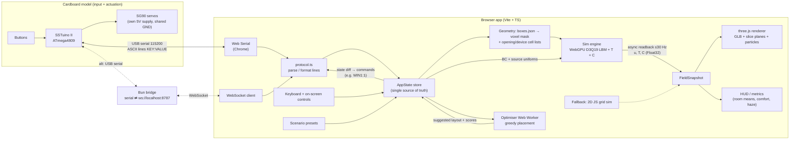

# 01 · Architecture

## Runtime picture
Everything runs on **one M4 Pro MacBook in Chrome** from `http://localhost` (a Vite dev server or `vite preview`). Web Serial and WebGPU both need a secure context, and `localhost` counts as one [U: confirm on the day by opening the page and checking `window.isSecureContext`]. There is no backend. The optional Bun bridge is a local helper process.



## Modules (contracts)
| Module | Input | Output | Notes |
|---|---|---|---|
| `geometry/` | `assets/hdb-3d/hdb_4room_boxes.json`, grid params | `VoxelGrid { nx,ny,nz,dx,origin, cellType:Uint8Array, openings: Map<name,Uint32Array cellIdx>, devices: Map<name,...>, roomOf: Uint8Array }` | Pure TS, unit-tested. **Only the JSON drives physics.** The GLB is visual only. |
| `sim/` | `VoxelGrid`, `SimParams`, `BoundaryState` | `FieldSnapshot { ux,uy,uz,T,C: Float32Array, step, simTime }` | WebGPU compute (WGSL). A CPU TS reference implementation of the same maths is used in tests and the optimiser. |
| `sim/fallback2d/` | 2D floor-plan raster | same `FieldSnapshot` shape with `ny=1` | Used if WebGPU fails (see doc 07). |
| `render/` | GLB, `FieldSnapshot`, `AppState` | canvas | three.js `WebGLRenderer` (see doc 03 for why not `WebGPURenderer`). |
| `io/` | serial/WS bytes, keyboard | `InputEvent`s → store, store diffs → command lines | Same parser for Web Serial and WS. |
| `optimiser/` | `AppState` snapshot (scenario, open/closed openings, current devices) | top-3 layouts with scores | Runs in a dedicated Web Worker. Never blocks the render loop. |
| `ui/` | `AppState` | DOM panel, HUD | Plain DOM/TS (no framework required). lil-gui is acceptable. |

## AppState (single source of truth)
```ts
type OpeningName = string;            // exact JSON/GLB names, e.g. "window_bedroom3_1", "main_door"
interface AppState {
  scenarioId: ScenarioId;             // doc 05
  openings: Record<OpeningName, boolean>;   // true = open
  fan:      { on: boolean; slot: number; angleDeg: number; speed: 0|1|2|3 };  // movable standing fan
  ac:       { on: boolean; unit: "ac_living"|"ac_master"|"ac_bedroom2"|"ac_bedroom3"; setC: number };
  purifier: { on: boolean; slot: number };
  ceilingFans: Record<string, boolean>;     // fan_living etc. (stretch)
  view:     { field: "T"|"C"|"speed"; sliceAxis: "y"|"x"|"z"; sliceH: number; particles: boolean; ceilingOpacity: number };
  link:     { kind: "none"|"webserial"|"ws"; connected: boolean; lastRx?: string };
  sim:      { backend: "webgpu"|"fallback2d"; paused: boolean; stepsPerFrame: number };
}
```
Every input path (hardware line, keyboard, on-screen button, scenario preset, optimiser "apply") produces the **same action** (e.g. `setOpening("window_bedroom3_1", true)`). Hardware never talks to the sim directly. Hardware-to-model name mapping lives in `config/mapping.ts` (doc 04).

## Frame loop
1. `requestAnimationFrame`: apply pending state changes → upload changed BC/source buffers (only on change).
2. Encode `stepsPerFrame` (default 8) LBM steps in one command encoder.
3. Every Nth frame (default every 2nd), copy macroscopic fields to a staging buffer and `mapAsync`. Never `await` it inside the frame; keep the latest completed snapshot.
4. Render three.js with the latest snapshot: update the `Data3DTexture`, advect particles on the CPU, update the HUD.
5. Target ≥30 fps on the M4 Pro. If the frame time is over 33 ms, reduce `stepsPerFrame` automatically (minimum 2).

## Performance budget (default grid 64×16×48 = 49,152 cells; see doc 02)
- f distributions: 19 × 49k × 4 B × 2 (ping-pong) ≈ 7.5 MB. T, C: 4 × 49k × 4 B ≈ 0.8 MB.
- Readback: 5 fields × 49k × 4 B ≈ 1 MB per snapshot, ≤30 Hz → trivial on Apple Silicon unified memory.
- Expect several thousand LBM steps/s on an M4 Pro at this size [U, not benchmarked]. The display "sim time" must be honest (see doc 02 scaling).

## Failure isolation
- If `navigator.gpu` is missing or `requestAdapter()` returns null: show a banner and switch to `fallback2d` automatically. The UI, protocol and optimiser keep working.
- A serial disconnect must never crash the sim. Show "Model disconnected" and keep keyboard control.
- Optimiser errors are caught in the worker and reported in the panel.
